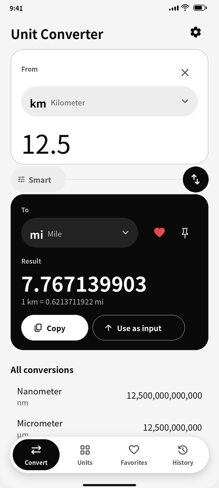
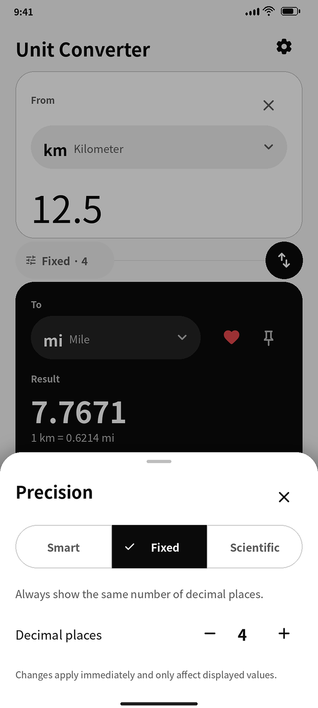
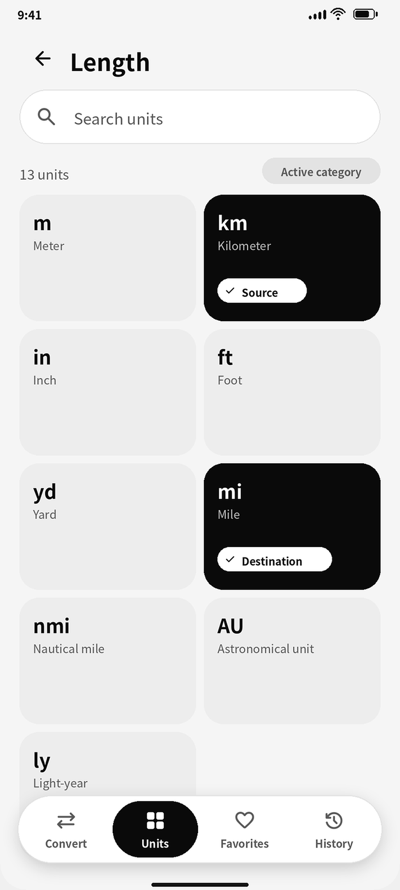
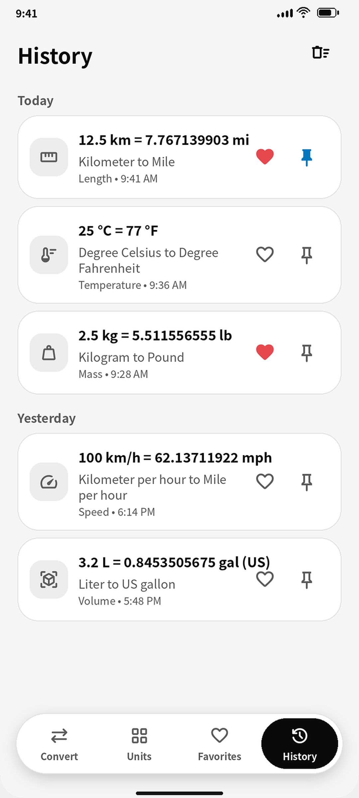
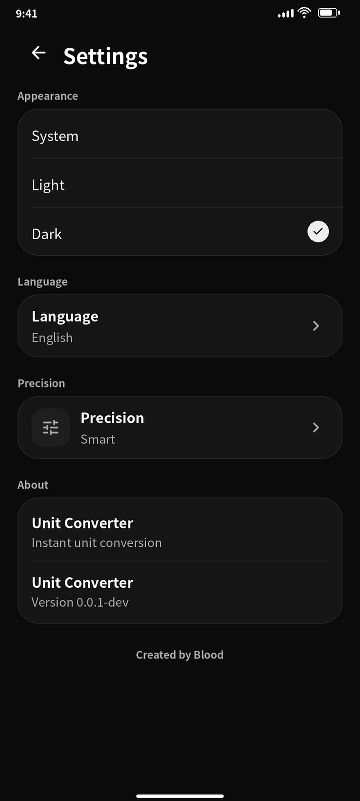
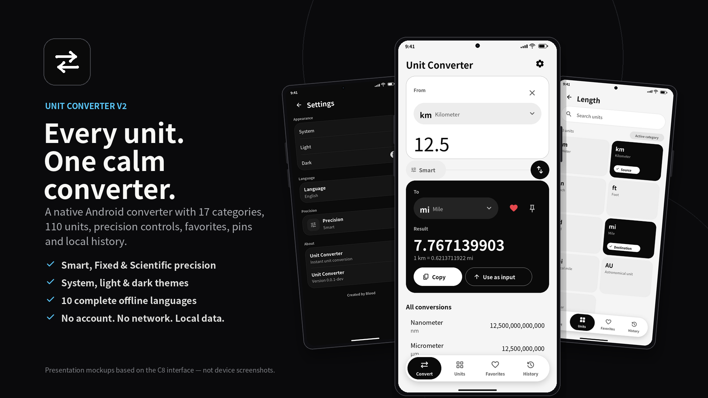

<div align="center">

<table>
  <tr>
    <td width="160" align="center" valign="middle">
      
    </td>
    <td valign="middle">
      <h1>Unit Converter V2.0.0</h1>
      <p><strong>Convert units. Keep it simple.</strong></p>
      <p>A modern native Android converter built with <strong>Kotlin</strong>, <strong>Jetpack Compose</strong> and <strong>Material 3</strong>. Fast, customizable, and ready to work offline.</p>
      <p>
        <a href="https://github.com/kiriliodas/Unit-Converter-V2/releases/latest"></a>
        <a href="#"></a>
        <a href="#"></a>
        <a href="THIRD_PARTY_NOTICES.md"></a>
      </p>
      <p>
        <a href="https://github.com/kiriliodas/Unit-Converter-V2/releases/latest"><strong>Download APK</strong></a> ·
        <a href="https://github.com/kiriliodas/Unit-Converter-V2">Browse source</a> ·
        <a href="https://github.com/kiriliodas/Unit-Converter-V2/issues">Report a bug</a>
      </p>
    </td>
  </tr>
</table>

</div>

---

## ✨ Made for everyday conversions

- **17 categories, 110 units** covering everything from length and temperature to data rates, pressure, energy and torque.
- **Instant results** with a conversion engine designed for accurate calculations.
- **Find units quickly** with a searchable unit catalog.
- **Save what matters** with favorites, pinned conversions and a history of copied results.
- **Choose your precision** with Smart, Fixed and Scientific formatting.
- **Make it yours** with System, Light and Dark themes, plus 10 interface languages.
- **Works offline** with your library and settings stored locally on your device.

## 📱 Screenshots

<table>
  <tr>
    <td align="center" width="50%">
      
      <br /><b>Convert</b>
      <br /><sub>A focused workspace for input and results.</sub>
    </td>
    <td align="center" width="50%">
      
      <br /><b>Clear results</b>
      <br /><sub>Read the converted value and manage the current pair.</sub>
    </td>
  </tr>
  <tr>
    <td align="center" width="50%">
      
      <br /><b>Find a unit</b>
      <br /><sub>Browse categories or search the catalog.</sub>
    </td>
    <td align="center" width="50%">
      
      <br /><b>Your library</b>
      <br /><sub>Keep favorite pairs, pin frequent conversions and revisit history.</sub>
    </td>
  </tr>
  <tr>
    <td align="center" width="50%">
      
      <br /><b>Personalize</b>
      <br /><sub>Set your theme, language and number precision.</sub>
    </td>
    <td align="center" width="50%">
      
      <br /><b>One simple toolkit</b>
      <br /><sub>Conversion tools in a consistent, native Android interface.</sub>
    </td>
  </tr>
</table>

## 🧰 What's included?

| Category | Units | Category | Units |
|---|---:|---|---:|
| Length | 13 | Temperature | 4 |
| Fuel economy | 4 | Mass | 7 |
| Area | 7 | Volume | 9 |
| Speed | 5 | Time | 6 |
| Digital storage | 10 | Data rate | 8 |
| Pressure | 8 | Energy | 7 |
| Power | 5 | Force | 4 |
| Frequency | 5 | Angle | 4 |
| Torque | 4 | | |

### Precision that fits the task

- **Smart:** up to 10 significant figures, with trailing zeros removed and scientific notation used for very large or small values when appropriate.
- **Fixed:** choose from 0 to 12 decimal places, including trailing zeros.
- **Scientific:** scientific notation with a configurable 0 to 12 decimal places in the mantissa.

Formatting rounds values using HALF_UP. Display precision does not change the conversion engine's internal value.

### Favorites, pins and history

- Favorite a specific source-to-target unit pair.
- Pin frequent pairs for quick access from the Convert screen.
- Copy a valid result to save it to history.
- Restore a saved conversion without losing the ability to edit the input.
- Keep your saved library between app launches.

### Languages and themes

Choose **System**, **Light** or **Dark** appearance. The interface language can follow your device or be set independently to **French, English, Spanish, Portuguese, German, Italian, Simplified Chinese, Japanese, Korean or Arabic**.

## 📥 Download and install

1. Open the [latest GitHub Release](https://github.com/kiriliodas/Unit-Converter-V2/releases/latest).
2. Download the APK attached to the release.
3. Open the downloaded file on your Android device and follow Android's installation prompts.

> **Compatibility:** Android 8.0 (API 26) or later.

If Android asks you to allow installation from that source, only continue if you downloaded the APK from this project's official GitHub Releases page and trust the source.

## 🔒 Privacy by design

Unit Converter is designed to work **offline and locally**.

- No account is required.
- No analytics or advertising SDKs are included.
- The app does not request the Android network permission.
- Favorites, pins, history and display preferences are stored in app-private local preferences.

Your saved conversion library is not sent to a remote service by the app.

## 🛠️ Build from source

### Requirements

- JDK 17
- Android SDK Platform 36 and the required build tools
- Network access for the first Gradle build
- Windows PowerShell for the commands below

The repository includes the Gradle Wrapper and pins Gradle 8.13.

### Build and test

Clone the repository, then open PowerShell in its root directory:

```powershell
git clone https://github.com/kiriliodas/Unit-Converter-V2.git
cd Unit-Converter-V2

.\gradlew.bat :app:compileDebugKotlin
.\gradlew.bat :app:testDebugUnitTest
.\gradlew.bat :app:lintDebug
.\gradlew.bat :app:assembleDebug
```

To create a release APK, configure the signing environment variables expected by `app/build.gradle.kts`:

- `UNIT_CONVERTER_STORE_PASSWORD`
- `UNIT_CONVERTER_KEY_PASSWORD`
- `UNIT_CONVERTER_KEYSTORE` (optional custom keystore path)

Then run:

```powershell
.\gradlew.bat :app:assembleRelease
```

Build outputs are generated under `app/build/outputs/apk/`. Signing keys, passwords, and local machine configuration must stay outside version control.

### Technical overview

| Item | Details |
|---|---|
| Platform | Native Android |
| Language | Kotlin |
| UI | Jetpack Compose, Material 3 |
| Application ID | `com.kirilliodas.unitconverter` |
| Kotlin namespace | `app.unitconverter` |
| Current version | `2.0.0` |
| Version code | `1` |
| Minimum Android version | Android 8.0 (API 26) |
| Compile / target SDK | 36 |
| Build system | Gradle 8.13 Wrapper |
| Automated tests | 153 JVM unit tests in the current release |

The conversion engine, parsing and formatting, unit catalog, preferences, navigation and conversion library are covered by JVM unit tests. The current release was built and validated on Windows, and the release APK was installed and tested on a Samsung Galaxy A23 5G.

## 🧭 Conversion conventions

A few deliberate choices help keep results consistent:

- **Digital storage:** decimal SI units use powers of 1,000 (`kB`, `MB`, `GB`); binary IEC units use powers of 1,024 (`KiB`, `MiB`, `GiB`). One byte equals eight bits.
- **Volume:** teaspoon, tablespoon and cup use US customary definitions, not metric spoons or the US nutrition-label cup.
- **Horsepower:** mechanical horsepower (`hp`) and metric horsepower (`PS`) are separate units.
- **Frequency:** `rpm` represents rotational frequency, not angular velocity in radians per second.
- **Energy and torque:** joules and newton-metres remain separate categories, even though they are dimensionally equivalent.
- **Calendar units:** months and years are excluded because their duration depends on calendar conventions.

## 🗺️ Project status

**Version 2.0.0 is released.** The current catalog contains 17 categories and 110 units. Future additions should use verified conversion definitions and include tests.

Found an issue or have an idea? [Open an issue on GitHub](https://github.com/kiriliodas/Unit-Converter-V2/issues).

## 📄 Notices

See [`THIRD_PARTY_NOTICES.md`](THIRD_PARTY_NOTICES.md) for third-party notices.

---

<div align="center">

Made with Kotlin and Jetpack Compose.

**[Download Unit Converter V2.0.0](https://github.com/kiriliodas/Unit-Converter-V2/releases/tag/v2.0.0)**

</div>
